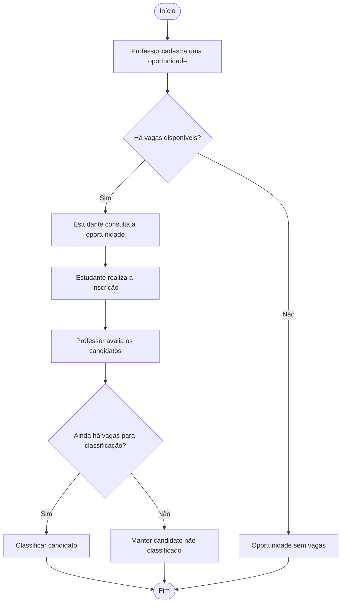
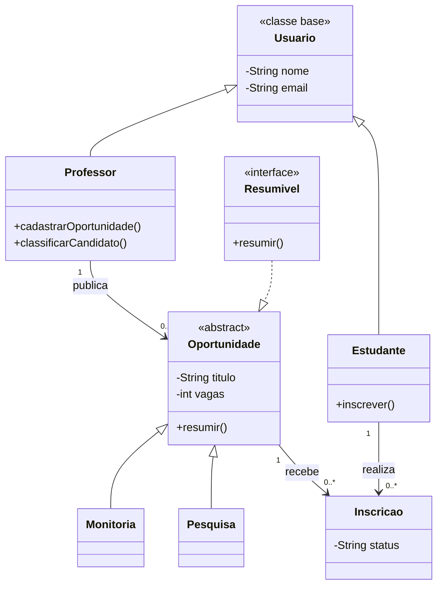

<div align="center">

  

  # 🎓 Projeto IPE

  ### Plataforma de Iniciação, Pesquisa e Extensão

  **Conectando estudantes a oportunidades acadêmicas.**

  <p>
    
    
    
    
  </p>

  <p>
    <a href="#-sobre-o-projeto">Sobre</a> •
    <a href="#-funcionalidades-previstas">Funcionalidades</a> •
    <a href="#-modelo-conceitual">Modelo conceitual</a> •
    <a href="#-como-executar">Execução</a>
  </p>

</div>

---

## 📌 Sobre o projeto

O **IPE** é um projeto acadêmico de uma plataforma de **Iniciação, Pesquisa e Extensão**, desenvolvido no contexto do componente curricular **Linguagem de Programação Orientada a Objetos (LPOO)**, da Licenciatura em Computação do **IFPE — Campus Afogados da Ingazeira**, no período letivo **2026.2**.

A proposta é organizar oportunidades acadêmicas: professores podem cadastrar oportunidades de monitoria ou pesquisa, e estudantes podem consultar e realizar inscrições. O professor avalia as candidaturas e classifica participantes respeitando o número de vagas.

> **Nota sobre o estado do projeto:** este repositório está em desenvolvimento. As funcionalidades descritas como previstas ou conceituais representam o escopo do trabalho e não devem ser entendidas automaticamente como funcionalidades já implementadas.

## 🎯 Objetivos

- Praticar os fundamentos da programação orientada a objetos em Java.
- Modelar entidades acadêmicas e seus relacionamentos.
- Representar oportunidades de monitoria e pesquisa.
- Trabalhar com inscrições, vagas e classificação de candidatos.
- Aplicar encapsulamento, herança, abstração, polimorfismo e tratamento de exceções ao longo das etapas do projeto.

## ✨ Funcionalidades previstas

- 👨‍🏫 Cadastro e identificação de professores.
- 🧑‍🎓 Cadastro e identificação de estudantes.
- 📚 Representação de oportunidades de monitoria e pesquisa.
- 📝 Inscrição de estudantes em oportunidades abertas.
- 📊 Classificação de candidatos pelo professor.
- 🚦 Validação de vagas disponíveis e de dados informados.

As funcionalidades serão consideradas concluídas à medida que forem implementadas e testadas no código.

## 🧭 Fluxo conceitual



*O diagrama apresenta o fluxo proposto para o sistema, não uma confirmação de que todas as etapas já estejam implementadas.*

## 🧩 Modelo conceitual

O modelo abaixo resume as principais entidades previstas no projeto e seus relacionamentos. Ele pode ser atualizado conforme a implementação evoluir.



**Atenção:** o diagrama é conceitual e pode incluir classes e métodos previstos no enunciado que ainda não aparecem nos arquivos atuais do repositório.

## 📏 Regras de negócio previstas

- Uma oportunidade deve possuir pelo menos uma vaga.
- Inscrições só devem ser aceitas enquanto a oportunidade estiver aberta.
- O número de estudantes classificados não pode ultrapassar a quantidade de vagas.
- Dados obrigatórios devem ser validados.
- A partir da etapa E3, o e-mail deve conter `@`.
- Senhas não devem ser disponibilizadas por métodos públicos de consulta (`getSenha`).

## 🧠 Conteúdos de POO trabalhados

| Conceito | Aplicação no projeto |
|---|---|
| Classes e objetos | Representação de usuários, oportunidades e inscrições |
| Encapsulamento | Proteção dos atributos e controle de acesso |
| Construtores | Inicialização dos objetos |
| Herança | Especialização de `Usuario` e `Oportunidade` |
| Abstração | Definição de comportamentos comuns em `Oportunidade` |
| Polimorfismo | Uso de referências de tipos mais gerais |
| Interfaces | Contrato comum para objetos que podem gerar resumo |
| Coleções | Armazenamento de oportunidades e inscrições |
| Exceções | Tratamento de situações inválidas, como vagas esgotadas |

## 🗺️ Etapas de desenvolvimento

| Etapa | Conteúdos previstos |
|---|---|
| **E1** | Classes, encapsulamento, herança, `toString()` e `@Override` |
| **E2** | Classe abstrata, polimorfismo, interface e sobrecarga |
| **E3** | `ArrayList`, exceções e validações |
| **Entrega final** | `HashMap`, `ArrayList`, `Scanner`, `instanceof` e menus |

## 🛠️ Tecnologias

- **Java** — linguagem de programação.
- **Git e GitHub** — versionamento e hospedagem do código.
- **Mermaid** — diagramas documentados no README.

## ▶️ Como executar

É necessário ter o **JDK (Java Development Kit)** instalado.

1. Clone o repositório:

   ```bash
   git clone https://github.com/jphs682/IPE.git
   ```

2. Entre na pasta:

   ```bash
   cd IPE
   ```

3. Confira os arquivos `.java` disponíveis e compile as classes implementadas. Por exemplo, se os arquivos estiverem na mesma pasta e não dependerem de classes ainda ausentes:

   ```bash
   javac *.java
   ```

4. Execute a classe que contém o método `main`, substituindo `NomeDaClasse` pelo nome real dessa classe:

   ```bash
   java NomeDaClasse
   ```

> **Importante:** a execução depende de existir uma classe com `public static void main(String[] args)` e de todas as dependências necessárias estarem presentes. O comando acima é um roteiro geral, não uma garantia de que a versão atual compile ou execute sem ajustes.

## 🗂️ Organização sugerida

A estrutura abaixo é uma sugestão para organizar o projeto conforme ele crescer; não representa necessariamente a estrutura atual do repositório.

```text
IPE/
├── assets/
│   └── banner.png
├── src/
│   ├── Usuario.java
│   ├── Professor.java
│   ├── Estudante.java
│   ├── Oportunidade.java
│   ├── Monitoria.java
│   ├── Pesquisa.java
│   └── Inscricao.java
├── README.md
└── .gitignore
```

## 🚧 Próximos passos sugeridos

- [ ] Completar e revisar as classes previstas no enunciado.
- [ ] Implementar validações e tratamento de exceções.
- [ ] Criar testes manuais para cenários válidos e inválidos.
- [ ] Atualizar o README quando cada funcionalidade for concluída.
- [ ] Registrar instruções de compilação e execução específicas da versão final.

## 🎓 Contexto acadêmico

**Instituição:** Instituto Federal de Educação, Ciência e Tecnologia de Pernambuco (IFPE)  
**Campus:** Afogados da Ingazeira  
**Curso:** Licenciatura em Computação  
**Componente curricular:** Linguagem de Programação Orientada a Objetos (LPOO)  
**Período:** 2026.2

---

<div align="center">

  **IPE — Iniciação, Pesquisa e Extensão**  
  *Um projeto acadêmico em evolução, construído com Java e orientação a objetos.*

  <sub>Desenvolvido para fins educacionais.</sub>

</div>
